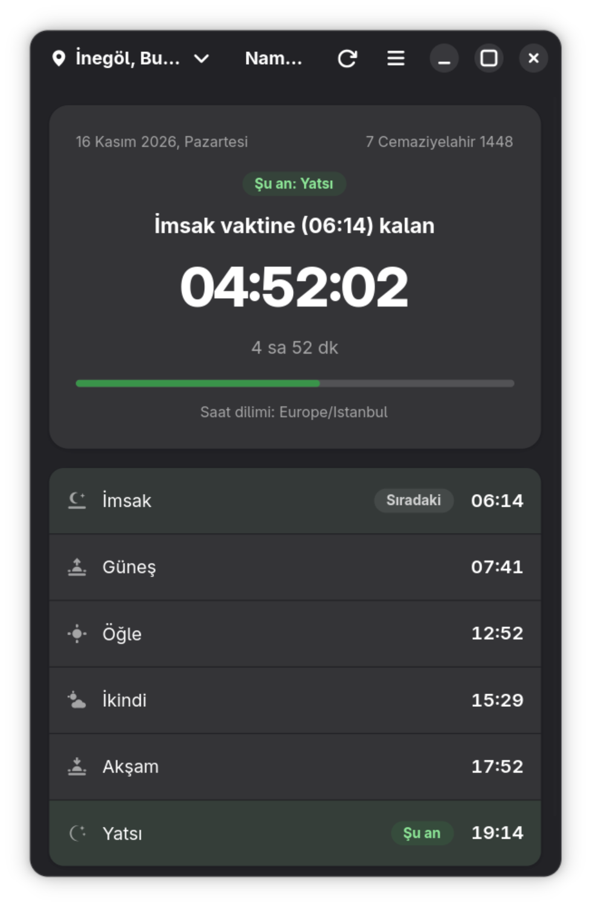
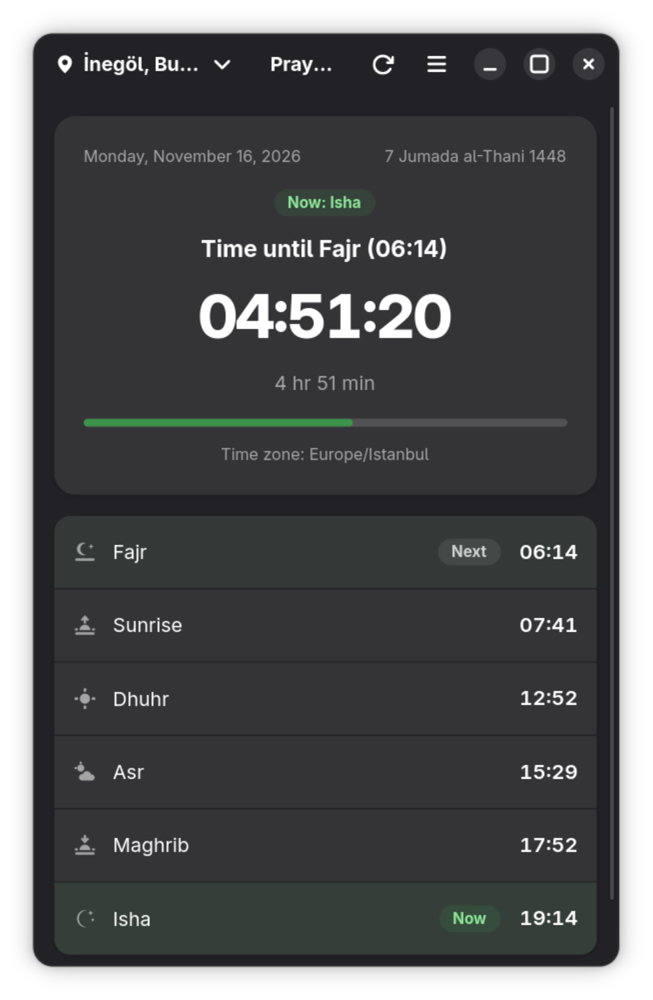
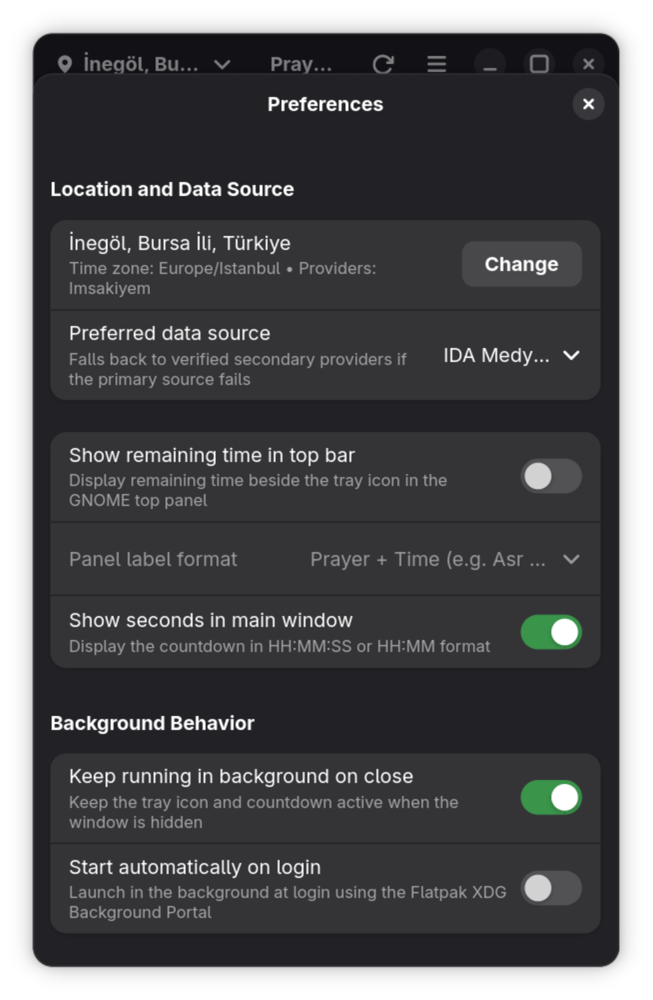
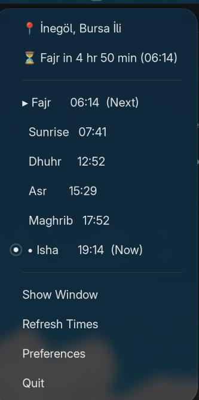

> 🇹🇷 [Türkçe sürüm → README_TR.md](README_TR.md)

# Namaz Vakti — Prayer Times (`io.github.bykemalh.namaz_time.NamazTime`)

A native prayer times and system tray (AppIndicator) application for the GNOME desktop, built with **GTK4**, **Libadwaita**, and **Rust**.

- **Repository:** https://github.com/bykemalh/namaz-time
- **Developer:** Kemal ([@bykemalh](https://github.com/bykemalh))
- **Languages:** Türkçe (`tr`), English (`en`), Русский (`ru`)
- **License:** MIT ([COPYING](COPYING))

## Screenshots

<table>
  <tr>
    <td align="center">
      
      <br />
      <sub><b>Main Window (Turkish)</b></sub>
    </td>
    <td align="center">
      
      <br />
      <sub><b>Main Window (English)</b></sub>
    </td>
  </tr>
  <tr>
    <td align="center">
      
      <br />
      <sub><b>Preferences Dialog</b></sub>
    </td>
    <td align="center">
      
      <br />
      <sub><b>GNOME Top Bar System Tray Menu</b></sub>
    </td>
  </tr>
</table>

## Features

- **GNOME / Libadwaita Interface:** Displays the active prayer, a live countdown to the next prayer (`HH:MM:SS` or `HH:MM`), a progress bar, Gregorian/Hijri dates, and all six daily prayer times in modern Adwaita cards.
- **Trilingual UI (Turkish, English, Russian):** Automatically detects the system language; switch between **Türkçe**, **English**, and **Русский** from Preferences at any time.
- **System Tray (GNOME Top Bar) & DBusMenu:**
  - A single click on the tray icon shows a menu with location summary, remaining time, all six prayer times, and quick actions (**Show Application**, **Refresh Times**, **Preferences**, **Quit**).
  - Optionally display the remaining time next to the tray icon in the GNOME top bar (`Prayer + Time` or `Time Only`), configurable from Preferences.
- **Background Operation & Autostart:** When the window is closed the app continues running in the system tray; it can be set to launch automatically at login via the XDG Background Portal.
- **3-Stage Validated Data Sources & Local Cache:**
  1. **İmsakiyem API** (primary; Turkey and worldwide)
  2. **mtopal Ezan Vakti v1.5** (fallback; Turkey and worldwide, local calculation with IANA time zones)
  3. **İDA Medya** (secondary fallback; Turkey only)
  - On failed requests, the app validates city/district names and falls through to the next source. When offline, it continues operating from the local XDG cache (`~/.cache/io.github.bykemalh.namaz_time.NamazTime`).

## System Requirements

- The **AppIndicator and KStatusNotifierItem Support** GNOME Shell extension must be enabled to see the tray icon and remaining time label in the GNOME top bar.

## Flatpak Packaging & Publishing

### 1. Install Required Flatpak SDKs and Tools

```bash
flatpak install --user flathub-user \
  org.flatpak.Builder \
  org.gnome.Platform//50 \
  org.gnome.Sdk//50 \
  org.freedesktop.Sdk.Extension.rust-stable//25.08
```

### 2. Build a Single-File `.flatpak` Bundle (For Local Installation & GitHub Releases)

The manifest ([io.github.bykemalh.namaz_time.NamazTime.json](io.github.bykemalh.namaz_time.NamazTime.json)) is configured to build all Rust dependencies fully offline thanks to [cargo-sources.json](cargo-sources.json):

```bash
flatpak run org.flatpak.Builder --user --force-clean --repo=repo build-dir io.github.bykemalh.namaz_time.NamazTime.json
flatpak build-bundle repo io.github.bykemalh.namaz_time.NamazTime-0.1.0-x86_64.flatpak io.github.bykemalh.namaz_time.NamazTime
```

Install and test the generated `.flatpak` bundle:

```bash
flatpak install --user ./io.github.bykemalh.namaz_time.NamazTime-0.1.0-x86_64.flatpak
flatpak run io.github.bykemalh.namaz_time.NamazTime
```

### 3. Local Build with Meson + `org.gnome.Sdk//50`

```bash
flatpak run --filesystem="$PWD" --command=sh org.gnome.Sdk//50 -c '
  meson setup _build --prefix=/app &&
  meson test -C _build &&
  meson compile -C _build
'
```

### 4. Push to GitHub & Prepare the Flathub Release

1. Push your changes to the `master` branch and create the `v0.1.0` release tag (this is required for the `v0.1.0` screenshot URLs in MetaInfo to be reachable on GitHub):

```bash
git add .
git commit -m "Prepare v0.1.0 release with screenshots, tr/en/ru translations, and Flathub app ID"
git push origin master
git tag -a v0.1.0 -m "Release v0.1.0"
git push origin v0.1.0
```

2. When opening a PR to the [flathub/flathub](https://github.com/flathub/flathub) repository (`new-pr` branch), replace the `"type": "dir"` source in [io.github.bykemalh.namaz_time.NamazTime.json](io.github.bykemalh.namaz_time.NamazTime.json) with the tagged Git source:

```json
{
    "type": "git",
    "url": "https://github.com/bykemalh/namaz-time.git",
    "tag": "v0.1.0",
    "commit": "<v0.1.0-commit-sha>"
}
```

> **Notes:**
> - The `io.github.bykemalh.namaz_time.NamazTime` app ID is verified directly through your GitHub account (`bykemalh`) on Flathub; no additional domain DNS/TXT configuration is needed.
> - To run the Flathub linter checks:
>   ```bash
>   flatpak run --filesystem="$PWD" --command=flatpak-builder-lint org.flatpak.Builder manifest io.github.bykemalh.namaz_time.NamazTime.json
>   flatpak run --filesystem="$PWD" --command=flatpak-builder-lint org.flatpak.Builder repo repo
>   ```
> - When `Cargo.lock` is updated, regenerate `cargo-sources.json` with `flatpak-cargo-generator Cargo.lock -o cargo-sources.json`.

## Data Sources

- [İmsakiyem API](https://ezanvakti.imsakiyem.com) (Diyanet data)
- [mtopal Ezan Vakti API v1.5](https://ezanvakti.emushaf.net) (Diyanet data)
- [İDA Medya Namaz Vakti API](https://api.idamedya.com) (Turkey / Diyanet data)
