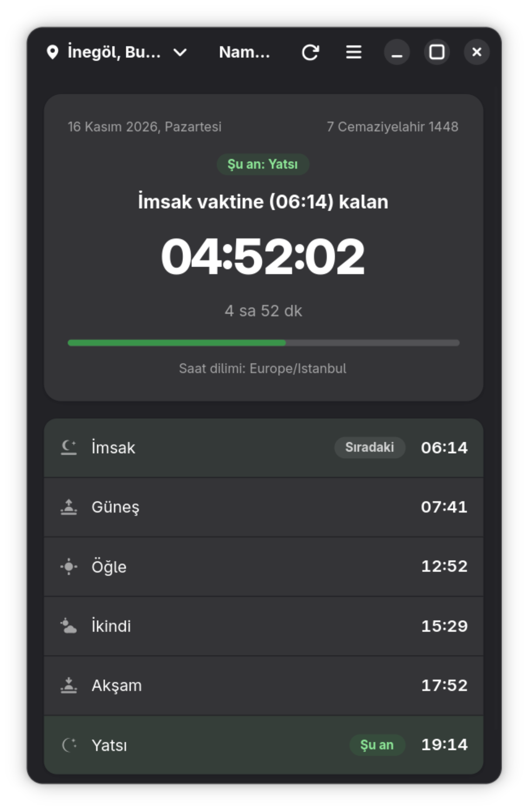
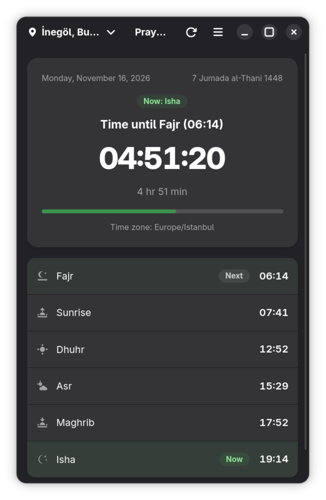
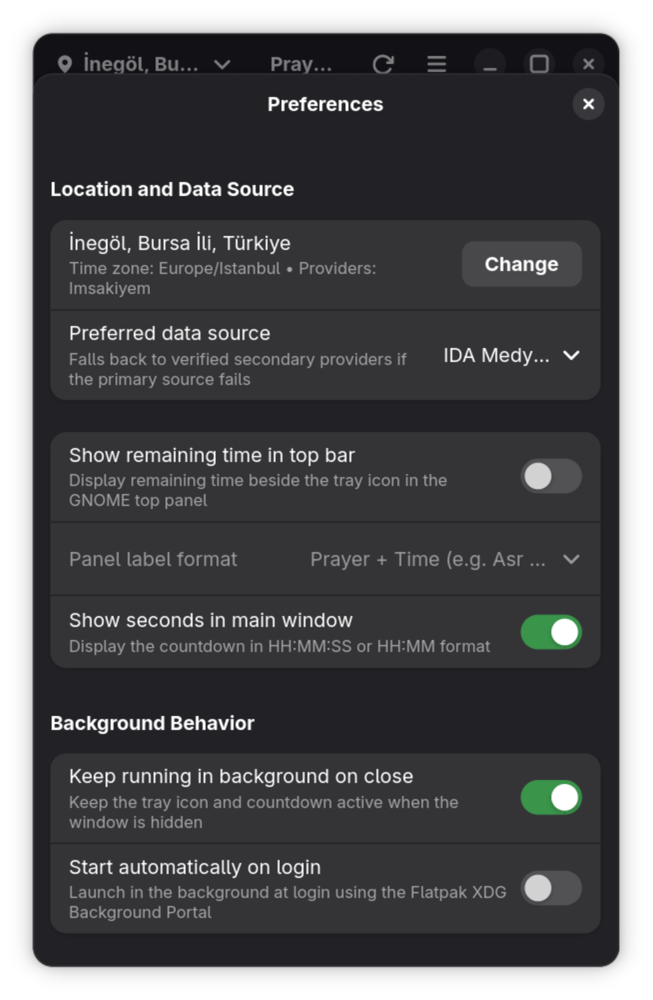
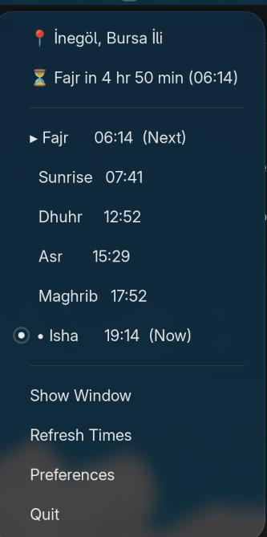

> 🇬🇧 [English version → README.md](README.md)

# Namaz Vakti (`io.github.bykemalh.namaz_time.NamazTime`)

GNOME masaüstü ortamı için **GTK4**, **Libadwaita** ve **Rust** ile geliştirilmiş yerel namaz vakitleri ve sistem tepsisi (AppIndicator) uygulaması.

- **Depo:** https://github.com/bykemalh/namaz-time
- **Geliştirici:** Kemal ([@bykemalh](https://github.com/bykemalh))
- **Diller:** Türkçe (`tr`), English (`en`), Русский (`ru`)
- **Lisans:** MIT ([COPYING](COPYING))

## Ekran Görüntüleri

<table>
  <tr>
    <td align="center">
      
      <br />
      <sub><b>Ana Pencere (Türkçe)</b></sub>
    </td>
    <td align="center">
      
      <br />
      <sub><b>Ana Pencere (İngilizce)</b></sub>
    </td>
  </tr>
  <tr>
    <td align="center">
      
      <br />
      <sub><b>Tercihler Penceresi</b></sub>
    </td>
    <td align="center">
      
      <br />
      <sub><b>GNOME Üst Çubuk Sistem Tepsisi Menüsü</b></sub>
    </td>
  </tr>
</table>

## Özellikler

- **GNOME / Libadwaita Arayüzü:** Aktif vakti, bir sonraki vakte kalan canlı geri sayımı (`SS:DD:SN` veya `SS:DD`), vakit ilerleme çubuğunu, Miladi/Hicri tarihi ve 6 günlük vakti modern Adwaita kartlarıyla gösterir.
- **3 Dilli Arayüz (Türkçe, İngilizce, Rusça):** Sistem dilini otomatik algılar; Tercihler içinden **Türkçe**, **English** veya **Русский** arasında geçiş yapılabilir.
- **Sistem Tepsisi (GNOME Top Bar) & DBusMenu:**
  - Tepsi ikonuna tek tıklandığında konum özeti, kalan süre, tüm 6 vakit ve hızlı işlemler (**Uygulamayı Göster**, **Vakitleri Yenile**, **Tercihler**, **Çıkış**) menüde görünür.
  - GNOME üst çubuğunda ikonun yanında kalan süreyi gösterme (`Vakit + Süre` veya `Yalnızca Süre`) Tercihler'den açılıp kapatılabilir.
- **Arka Planda Çalışma & Otomatik Başlatma:** Pencere kapatıldığında uygulama tepside arka planda çalışmaya devam eder; oturum açılışında XDG Background Portalı ile otomatik başlatılabilir.
- **3 Aşamalı Doğrulamalı Diyanet Veri Kaynağı & Yerel Önbellek:**
  1. **İmsakiyem API** (birincil; Türkiye ve dünya geneli)
  2. **mtopal Ezan Vakti v1.5** (yedek; Türkiye ve dünya geneli, IANA saat dilimiyle yerel hesaplama)
  3. **İDA Medya** (ek yedek; yalnızca Türkiye)
  - Başarısız isteklerde isim/ilçe doğrulamasıyla sıradaki kaynağa geçer, bağlantı olmadığında yerel XDG önbellekten (`~/.cache/io.github.bykemalh.namaz_time.NamazTime`) çalışmayı sürdürür.

## Sistem Gereksinimleri

- GNOME üst panelinde tepsi ikonunu ve kalan süre etiketini görmek için **AppIndicator and KStatusNotifierItem Support** GNOME Shell eklentisinin etkin olması gerekir.

## Flatpak Paketleme & Yayınlama

### 1. Gerekli Flatpak SDK ve Araçları Kurun

```bash
flatpak install --user flathub-user \
  org.flatpak.Builder \
  org.gnome.Platform//50 \
  org.gnome.Sdk//50 \
  org.freedesktop.Sdk.Extension.rust-stable//25.08
```

### 2. Tek Dosya `.flatpak` Paketi Oluşturun (Yerel Kurulum ve GitHub Releases İçin)

Manifest ([io.github.bykemalh.namaz_time.NamazTime.json](io.github.bykemalh.namaz_time.NamazTime.json)), [cargo-sources.json](cargo-sources.json) sayesinde tüm Rust bağımlılıklarını ağ erişimi olmadan çevrimdışı (offline) derleyecek şekilde yapılandırılmıştır:

```bash
flatpak run org.flatpak.Builder --user --force-clean --repo=repo build-dir io.github.bykemalh.namaz_time.NamazTime.json
flatpak build-bundle repo io.github.bykemalh.namaz_time.NamazTime-0.1.0-x86_64.flatpak io.github.bykemalh.namaz_time.NamazTime
```

Üretilen `.flatpak` dosyasını kurup test etmek için:

```bash
flatpak install --user ./io.github.bykemalh.namaz_time.NamazTime-0.1.0-x86_64.flatpak
flatpak run io.github.bykemalh.namaz_time.NamazTime
```

### 3. Yerel Meson + `org.gnome.Sdk//50` İle Derleme

```bash
flatpak run --filesystem="$PWD" --command=sh org.gnome.Sdk//50 -c '
  meson setup _build --prefix=/app &&
  meson test -C _build &&
  meson compile -C _build
'
```

### 4. GitHub'a Yükleme ve Flathub Release Hazırlığı

1. Değişiklikleri `master` dalına push edin ve `v0.1.0` sürüm etiketini oluşturun (MetaInfo içindeki `v0.1.0` ekran görüntüsü bağlantılarının GitHub'dan erişilebilmesi için bu adım önemlidir):

```bash
git add .
git commit -m "Prepare v0.1.0 release with screenshots, tr/en/ru translations, and Flathub app ID"
git push origin master
git tag -a v0.1.0 -m "Release v0.1.0"
git push origin v0.1.0
```

2. [flathub/flathub](https://github.com/flathub/flathub) (`new-pr`) reposuna PR açarken [io.github.bykemalh.namaz_time.NamazTime.json](io.github.bykemalh.namaz_time.NamazTime.json) içindeki `"type": "dir"` kaynağını etiketlenmiş Git kaynağıyla değiştirin:

```json
{
    "type": "git",
    "url": "https://github.com/bykemalh/namaz-time.git",
    "tag": "v0.1.0",
    "commit": "<v0.1.0-commit-sha>"
}
```

> **Notlar:**
> - `io.github.bykemalh.namaz_time.NamazTime` kimliği doğrudan GitHub hesabınız (`bykemalh`) üzerinden Flathub'da doğrulanır; ek alan adı DNS/TXT ayarı gerekmez.
> - Flathub lint kontrolü için:
>   ```bash
>   flatpak run --filesystem="$PWD" --command=flatpak-builder-lint org.flatpak.Builder manifest io.github.bykemalh.namaz_time.NamazTime.json
>   flatpak run --filesystem="$PWD" --command=flatpak-builder-lint org.flatpak.Builder repo repo
>   ```
> - `Cargo.lock` güncellendiğinde `cargo-sources.json` dosyasını `flatpak-cargo-generator Cargo.lock -o cargo-sources.json` ile yeniden üretebilirsiniz.

## Veri Kaynakları

- [İmsakiyem API](https://ezanvakti.imsakiyem.com) (Diyanet verisi)
- [mtopal Ezan Vakti API v1.5](https://ezanvakti.emushaf.net) (Diyanet verisi)
- [İDA Medya Namaz Vakti API](https://api.idamedya.com) (Türkiye / Diyanet verisi)
